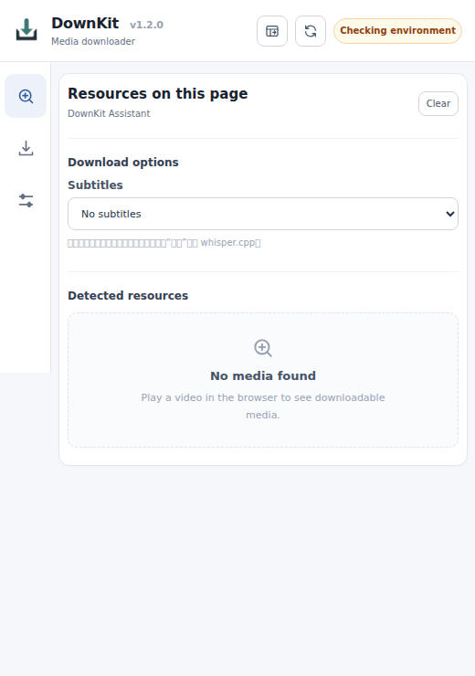

# DownKit

[简体中文](README_ZH.md) · [Documentation](docs/index.md) · [Releases](https://github.com/ThinkerQAQ/downkit/releases)

DownKit discovers HLS, DASH, MP4 and split media tracks in Chrome/Edge and downloads them using a local Go Bridge. Desktop downloads support optional subtitle extraction, speech recognition and translation. An independent Android app accepts shared media URLs.

## Quick Start

**New to DownKit?** Follow the [illustrated first-run guide](docs/tutorial/first-run-on-new-machine.md) for the release installation, browser extension, Bridge connection, and first download. The [troubleshooting guide](docs/how-to/troubleshoot.md) covers connection and media-detection failures.

Download a [desktop release](https://github.com/ThinkerQAQ/downkit/releases) and extract the complete archive. On Windows run `bin\downkitdev.exe install`; on Linux/macOS run `./bin/downkitdev install`. All installer and release logic is Go-owned. Linux and macOS also require FFmpeg in PATH.

Open `chrome://extensions` or `edge://extensions`, enable Developer mode and load the unpacked `extension/` folder. Play a video, click DownKit, detect its media and download it. The installed extension starts the Bridge automatically through Native Messaging.

## Interface preview

This is a genuine initial screen from an isolated Chromium profile. It has no detected media, and does not demonstrate a completed download. See the [first-run walkthrough](docs/tutorial/first-run-on-new-machine.md) for a second Settings screenshot and the exact steps.

## Control surfaces

Popup, Side Panel and local **Web UI** share the same task and settings modules. Click **Open workspace** in the extension to access `http://127.0.0.1:17891/console/`. The extension is required for privileged requests; the HTTP page cannot read the Bridge authentication token.

## Capabilities and limitations

- Go desktop downloader with job progress, retry and resume where supported
- Optional yt-dlp resolver, FFmpeg muxing, whisper.cpp transcription and llama.cpp translation
- Windows release carries local ASR/translation executables without model weights; Linux/macOS release capabilities differ
- Android currently accepts direct MP4/HLS URLs; arbitrary webpages and split-track YouTube media are not generally supported on Android

See [Quick Start](docs/quick-start.md), [Tutorial](docs/tutorial/first-download.md), [How-to](docs/how-to/index.md), [Reference](docs/reference/index.md) and [Architecture](docs/architecture/index.md).

## Development

DownKit is managed through DEV2. Start with [AGENTS.md](AGENTS.md), run `devtool config validate` and `devtool project inspect --json`, then use the declared `devtool verify` and `devtool build` commands. Go-owned build and verification commands replace the legacy shell completion gate.

Project code and documentation are Apache-2.0 licensed. Bundled third-party tools carry their own licence terms; see [NOTICE](NOTICE) and [THIRD_PARTY_NOTICES.md](THIRD_PARTY_NOTICES.md).

## Local configuration and data

Installed binaries reside in `bin/`; local runtime files are stored in the sibling `Data/` directory. Edit `Data/config.toml` for the download, proxy, tools, interface, sniffer and logging settings. Job state (`jobs.json`), Bridge runtime state (`bridge.json`), logs, models, downloaded tool components and staging checkpoints live under `Data/`. Native Messaging requires a JSON registration manifest at `Data/native-host/com.downkit.bridge.json`; it is generated protocol metadata, not a user config file. Existing download destinations remain unchanged when migrating legacy configuration.

DEVTool delegates to [the Go maintainer](docs/architecture/devtool.md) in `tools/downkitdev/` for release packaging, installation and cross-platform builds. The native Media and Android SDKs keep their upstream build tools.
