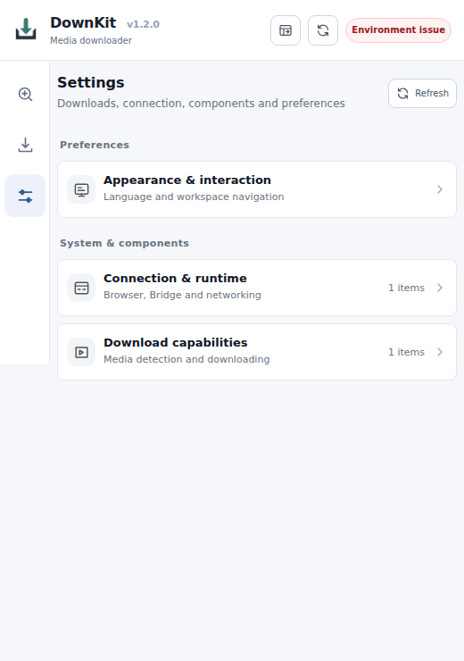

# First run on a new machine

**Goal:** install the desktop Bridge, connect the browser extension, identify a media file and find the finished download. You do not need Go, Node.js, an account, or speech-recognition models to use a packaged release.

This walkthrough is for **DownKit v1.2.0**. The screenshots were captured from the real v1.2.0 extension in an isolated Chromium profile, in English. That profile did **not** connect to Native Messaging, so they illustrate the initial screens and navigation—not a successful connection, detected video, or completed download.

## 1. Download the desktop package

Open [DownKit Releases](https://github.com/ThinkerQAQ/downkit/releases), choose the archive for **your operating system and CPU**, and extract it to a directory you intend to keep.

A desktop release has this layout:

- \`bin/\` — Bridge executable and the Go installer
- \`extension/\` — unpacked Chrome/Edge extension
- \`tools/\` — packaged media tools, where available
- \`Data/\` — persistent settings and jobs, created at runtime

**Do not** load the ZIP itself as an extension or move \`bin/\` away from \`extension/\`. Preserve \`Data/\` across upgrades. Windows packages include FFmpeg; on Linux/macOS, install FFmpeg in \`PATH\` before downloading HLS/DASH streams. Speech recognition and translation models are optional and not included.

## 2. Register the local Bridge

Open a terminal **in the extracted directory**:

**Windows — PowerShell**

~~~powershell
.\bin\downkitdev.exe install
~~~

**Linux/macOS — Terminal**

~~~sh
./bin/downkitdev install
~~~

The command registers the native messaging host \`com.downkit.bridge\` with supported browsers. It does **not** start a permanently running server. The extension starts the Bridge as needed.

You should see a **Native Messaging installed** line naming the executable and a **Host manifest** location under \`Data/native-host/\`. If the command fails, stop here and consult [Connection troubleshooting](../how-to/troubleshoot.md). For an extension installed under a different ID, re-run install with \`--extension-id YOUR_32_CHARACTER_ID\`.

## 3. Load the browser extension

1. Open \`edge://extensions\` or \`chrome://extensions\`.
2. Turn on **Developer mode**.
3. Choose **Load unpacked** and select the extracted **\`extension/\` directory**, the one containing \`manifest.json\`.
4. Pin DownKit to the browser toolbar, then click its icon.

DownKit provides three destinations: **Detect**, **Downloads**, and **Settings**. The upper-right indicator should eventually report a healthy environment. If it remains **Checking environment** or shows **Environment issue**, the Bridge has not been verified. Do not proceed assuming downloads will work.

*Real extension UI in a fresh, isolated Chromium profile. “No media found” is an empty state; the screenshot does not demonstrate a working Native Messaging connection.*

## 4. Choose language and inspect settings

Open **Settings → Appearance & interaction → Interface language**. Select **English** or **中文**. This controls the interface only; it does not translate videos or change the subtitle language. The same settings surface also controls the popup/side-panel opening preference.

*Real English Settings navigation in the isolated profile. Check the environment indicator independently on your installed browser.*

Under **Settings → Connection & runtime**, check the browser/Bridge status. Download-related tools appear under **Download capabilities**. For a first download, leave subtitles set to **No subtitles**; neither whisper.cpp nor llama.cpp needs a model for that path.

## 5. Find a permitted video

1. Open a website with a video you are authorized to save, and **start playback**.
2. While keeping that tab open, click DownKit and choose **Detect**.
3. In **Detected resources**, select the matching HLS (\`.m3u8\`), DASH (\`.mpd\`), or MP4 resource. Pages may expose multiple qualities, audio tracks, segments, or playlists. Prefer the playable manifest or complete media file over a single segment.
4. Set **Subtitles → No subtitles** for your first attempt, then click **Download** on the resource.

**Expected result:** a new job appears under **Downloads**. If nothing is detected, try playing/seeking the video once; some sites fetch media only after playback. DRM-protected video and arbitrary sites are not guaranteed to work. A resource appearing in Detect is **not** itself proof that it can be downloaded.

For playlist choices, subtitle modes, and an end-to-end explanation, see [Your first download](first-download.md).

## 6. Confirm the result

Open **Downloads** and find the newly created job. Wait until its status is **Completed**, then use the available output-file action or inspect the directory configured under **Settings → Download capabilities**. A job stuck in processing is not completed; read its error rather than repeatedly submitting duplicates.

You can also use **Open workspace** in the extension header for a larger browser tab at \`http://127.0.0.1:17891/console/\`. This address is loopback-only. The Web UI requires the extension relay to perform privileged operations; opening the address by itself does not connect the browser.

## 7. If it does not work

- **Native Messaging host not found / Environment issue:** run the installer again from the extracted root, verify the extension ID and reload the extension.
- **Checking environment never finishes:** open Settings, refresh, and check the Bridge connection before attempting a download.
- **No media found:** return to the original playing tab; navigate or play again and reopen Detect.
- **Missing FFmpeg or unsupported format:** inspect Download capabilities; Linux/macOS need an external FFmpeg installation.
- **Failed job:** inspect the error and the Bridge logs in \`Data/logs/\`. Do not assume the page or source supports downloading.

See [Troubleshooting](../how-to/troubleshoot.md) and [Configuration](../reference/configuration.md). For developers, [Go maintenance](../architecture/maintenance.md) explains the supported build and verification commands.

## Reproduction notes

On 2026-10-11, the Linux Bridge was built using the development tooling available at that time (now replaced by the native Go maintainer). The packaged-layout installer was exercised with a **temporary HOME and Data directory**, and Chromium loaded the real v1.2.0 extension. Its isolated Native Messaging connection could not be established; the screenshots therefore show initial/disconnected states and **no fabricated resources, jobs, or successful downloads**. A complete browser-to-download run on a new machine is **not claimed** here.