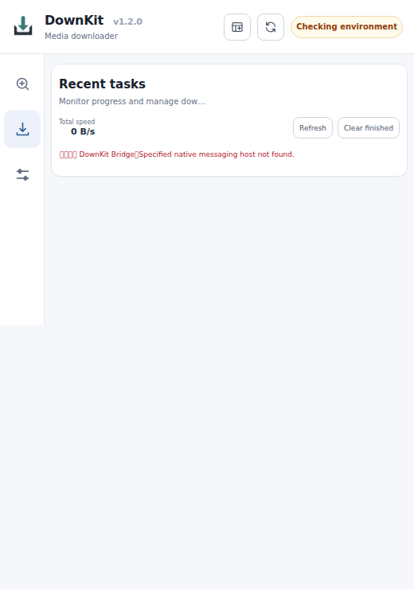

# 首次安装的故障排查

请按[新电脑首次使用教程](../tutorial/first-run-on-new-machine.md)的顺序排查。先确认浏览器与 Bridge 的连接，再检查下载器、代理或字幕模型；不要反过来处理。

## 找不到 Native Messaging host

浏览器通过名称为 \`com.downkit.bridge\` 的注册项启动 Bridge，**不是**直接查找任意运行中的 downkit 进程。

1. 在**解压后的根目录**用 PowerShell 执行 \`.\bin\downkitdev.exe install\`，或在 Linux/macOS 执行 \`./bin/downkitdev install\`。
2. 检查安装器是否输出了 Bridge 可执行文件路径和 \`Data/native-host/\` 下的 manifest 路径。
3. 在 \`chrome://extensions\` 或 \`edge://extensions\` 查看 DownKit 的扩展 ID。如果不等于 \`hfjpenjlamneepmigemmmiibebpokmik\`，重新执行安装命令并加上 \`--extension-id 实际的32位ID\`。
4. 在浏览器的扩展页点击「重新加载」。如果后来移动过程序目录，必须在新目录重新安装。

*这是隔离 Chromium 下真实的 v1.2.0 **连接失败** 截图，绝非正常连接或下载成功截图。*

## 环境状态一直显示 Checking environment

先通过浏览器工具栏的扩展图标启动，而不是直接输入 Web UI 地址。扩展会按需拉起 Bridge。在「设置 → 连接与运行环境」刷新健康状态。

Bridge 启动后，可以从**本机**检查 \`http://127.0.0.1:17891/\`。但本地端口能够响应，并不能证明扩展已经完成 Native Messaging 认证。不要将本地接口暴露到公网。

重装前先检查并停止旧的冲突进程，不要删除持久数据 \`Data/\`。日志位于 \`Data/logs/\`。

## 资源嗅探显示「暂无媒体资源」

- 回到原来的视频标签页，点击播放或拖动进度条。
- 确认当前检测的是正在播放的那个标签页。
- 优先找完整的 MP4、\`.m3u8\` 或 \`.mpd\`，而不是单独分片。
- DRM、特殊跨域请求或专有播放协议不保证支持。

没有检测结果只是尚未提交任务，不属于下载失败。具体看[第一次下载](../tutorial/first-download.md)。

## 任务创建了但下载失败

进入「下载任务」读取错误与失败阶段，检查 FFmpeg、媒体地址及会话是否过期、代理和下载目录写入权限。默认「不下载字幕」无需模型；本地 ASR 需要 whisper.cpp 和模型，本地翻译需要 llama.cpp 和模型。

网络超时后不要连续重复点击下载，应先确认是否已有任务，再尝试界面支持的重试或恢复操作。查看 \`Data/logs/\` 时注意不要分享鉴权信息或带签名的媒体 URL。

## 工作台打开了，但操作不生效

\`http://127.0.0.1:17891/console/\` 的授权操作依赖浏览器扩展转发，页面本身不持有 Bridge token。应从扩展的「打开工作台」进入，并检查扩展权限及连接状态；静态页面能加载不代表下载器已经接通。